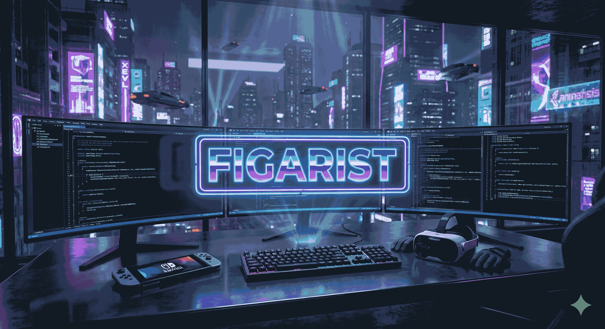
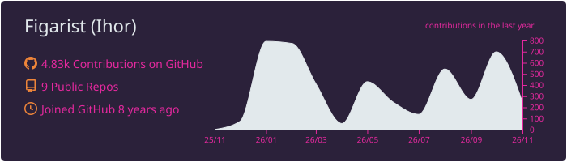
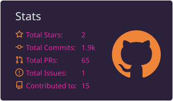
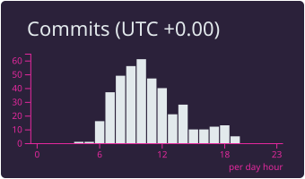
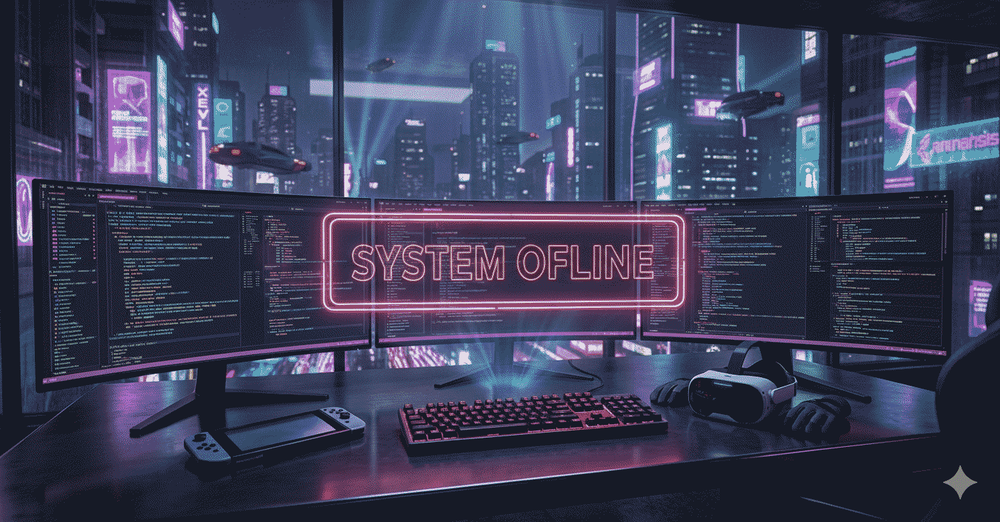

<div align="center">
  
</div>

<div align="center">
  
</div>

<div align="center">

### Ihor Sivochka (Ігор Сівочка / Figarist)
**Certified Unity Developer · Computer Science Mentor · EdTech & Wear OS Creator**

[](https://sivochka.com/)
[](https://sivochka.com/tutoring/)
[](https://wristandpocket.dev/)
[](https://www.youtube.com/@proVR_ua)
[](https://t.me/proVR_ua)

<br/>

[](https://discordapp.com/users/201598908030386176)
[](https://www.facebook.com/Figarist/)
[](https://www.instagram.com/figarist.xom/)
[](https://www.threads.com/@figarist.xom)
[](https://steamcommunity.com/id/figaristo/)
[](https://open.spotify.com/user/lxw74ycexoku13aass8t92lp9)

</div>

<br/>

- 🌐 **Personal Hub & 4-Language Blog (`EN` · `UK` · `RU` · `KO`):** [sivochka.com](https://sivochka.com/) · [Українська версія](https://sivochka.com/uk/)
- 🎓 **Individual 1-on-1 Mentoring (Unity/C#, Python, Scratch, CS, 3D):** [sivochka.com/tutoring/](https://sivochka.com/tutoring/) · [Українською](https://sivochka.com/uk/tutoring/)
- ⌚ **Indie Game Studio (Android & Wear OS):** [wristandpocket.dev](https://wristandpocket.dev/) · [@wristandpocket](https://github.com/wristandpocket)
- 📺 **Video & Community:** [YouTube @proVR_ua](https://www.youtube.com/@proVR_ua) · [Telegram @proVR_ua](https://t.me/proVR_ua)

---

## 🚀 Live Web Apps, EdTech Tools & Design Systems

| Project | Purpose | Live App | GitHub Repo | Technical Guide (`sivochka.com`) |
| --- | --- | --- | --- | --- |
| 🎛️ **OGCruncher** | Retro 8-bit/16-bit audio bit-crusher, chiptune processor & batch OGG/WAV/MP3 optimizer (Web Audio API) | [sivochka.com/OGCruncher/](https://sivochka.com/OGCruncher/) | [Figarist/OGCruncher](https://github.com/Figarist/OGCruncher) | [EN Guide](https://sivochka.com/blog/ogcruncher-game-audio-bitcrusher/) · [UK Гайд](https://sivochka.com/uk/blog/ogcruncher-game-audio-bitcrusher/) |
| ⚒️ **3D Club Studio** | Offline browser 3D modeling studio (Three.js) & 100% support-free STL generator for school STEM clubs | [sivochka.com/3d-club-studio/](https://sivochka.com/3d-club-studio/) | [Figarist/3d-club-studio](https://github.com/Figarist/3d-club-studio) | [EN Guide](https://sivochka.com/blog/3d-club-studio-minecraft-print-safe/) · [UK Гайд](https://sivochka.com/uk/blog/3d-club-studio-minecraft-print-safe/) |
| 🧱 **LEGO WeDo 2.0 Catalog** | Interactive offline-first PWA catalog of 597 robotics PDF building instructions across 26 categories | [sivochka.com/lego-catalog/](https://sivochka.com/lego-catalog/) | [Figarist/lego-catalog](https://github.com/Figarist/lego-catalog) | [EN Guide](https://sivochka.com/blog/lego-wedo-2-0-instructions-catalog/) · [UK Гайд](https://sivochka.com/uk/blog/lego-wedo-2-0-instructions-catalog/) |
| 🤫 **Quiet Class (`Тихий Клас`)** | Gamified Web Audio DSP classroom noise meter, group star tracker & Verlet physics PWA for teachers | [sivochka.com/bouncy/](https://sivochka.com/bouncy/) | [Figarist/bouncy](https://github.com/Figarist/bouncy) | [EN Guide](https://sivochka.com/blog/quiet-class-classroom-noise-meter/) · [UK Гайд](https://sivochka.com/uk/blog/quiet-class-classroom-noise-meter/) |
| 🖥️ **Can I Run Unity?** | In-browser hardware compatibility analyzer, FPS/compile estimator & Local AI readiness checker for Unity | [sivochka.com/canirunUnity/](https://sivochka.com/canirunUnity/) | [Figarist/canirunUnity](https://github.com/Figarist/canirunUnity) | [Tool Hub](https://sivochka.com/) |
| 🐍 **pyScratch** | Browser-based bidirectional Python DSL ↔ Scratch 3.0 (`.sb3`) compiler, decompiler & Canvas 2D simulator | [sivochka.com/pyScratch/](https://sivochka.com/pyScratch/) | [Figarist/pyScratch](https://github.com/Figarist/pyScratch) | [Tool Hub](https://sivochka.com/) |
| ⌚ **WearView 3D** | Physically-aware 3D smartwatch previewer for 21 Wear OS devices, safe zones & OLED AOD checker | [wristandpocket.dev/wearview/](https://wristandpocket.dev/wearview/) | [wristandpocket/wearview](https://github.com/wristandpocket/wearview) | [Tool Overview](https://wristandpocket.dev/tools/wearview/) |
| 🎨 **Friendly Arcade UI** | Zero-dependency offline CSS design system & WCAG AAA components for kids' EdTech web apps | [sivochka.com/friendly-arcade/](https://sivochka.com/friendly-arcade/) | [Figarist/friendly-arcade](https://github.com/Figarist/friendly-arcade) | [Hub Architecture (EN)](https://sivochka.com/blog/jekyll-spaceship-hub-architecture/) · [UK](https://sivochka.com/uk/blog/jekyll-spaceship-hub-architecture/) |
| 🌑 **Wrist & Pocket UI** | Zero-dependency obsidian dark design system (`--wp-*` tokens, WCAG AA/AAA) for Wear OS studio web apps | [sivochka.com/wrist-pocket-ui/](https://sivochka.com/wrist-pocket-ui/) | [Figarist/wrist-pocket-ui](https://github.com/Figarist/wrist-pocket-ui) | [Studio Showcase](https://wristandpocket.dev/games/) |

---

## 🎓 1-on-1 Mentoring & Computer Science Education

I help children and teenagers (ages 6+) build real games, algorithms, and 3D projects in individual online lessons:

- 🎮 **[Unity & C# Game Development](https://sivochka.com/tutoring/unity/)** — 2D/3D mechanics, physics, OOP architecture, and publishing playable projects
- 🐍 **[Python Programming & Minecraft](https://sivochka.com/tutoring/python/)** — Algorithms, problem solving, and spatial coding ([Minecraft + Python Guide](https://sivochka.com/blog/minecraft-python/) · [UK](https://sivochka.com/uk/blog/minecraft-python/))
- 🧩 **[Scratch Visual Programming](https://sivochka.com/tutoring/scratch/)** — First interactive games, animations, events, and logic for younger learners
- 💻 **[School Informatics & All Directions](https://sivochka.com/uk/tutoring/)** — Structured support, 3D modeling, and project-based STEM mentoring

---

## 🏅 Certifications & Credentials

- 🏆 **[Unity Certified Junior Programmer](https://www.credly.com/badges/d224022a-58d0-4f18-be4d-5a13521335a4)** — Official Unity Technologies Certification (Credly)
- ✅ **[Unity Essentials](https://www.credly.com/badges/98a97882-cfc9-4509-85ca-663c31989ef4)** — Official Unity Technologies Certification (Credly)
- 🎓 **Master's Degree in Secondary Education (Computer Science & Mathematics)** — H.S. Skovoroda Kharkiv National Pedagogical University ([Verified Profile on BUKI](https://buki.com.ua/user-82505/))

---

## 🌆 𝙰𝚋𝚘𝚞𝚝 𝙼𝚎

```typescript
const figarist = {
    name: "Ihor Sivochka (Ігор Сівочка)",
    location: "Kharkiv, Ukraine UA",
    role: "Certified Unity Developer, CS Mentor & EdTech Creator",
    website: "https://sivochka.com",
    tutoring: "https://sivochka.com/tutoring/",
    studio: "https://wristandpocket.dev",

    focus: {
        gamedev: "Unity 6, C#, Android & Wear OS Smartwatches",
        edtech: "Offline-first browser tools (Web Audio, Three.js, PWA)",
        teaching: "1-on-1 mentoring in Unity, Python, Scratch & Informatics",
        architecture: "Clean OOP, WCAG accessibility & Spec-Driven Development"
    },

    passions: ["Nintendo Switch / DS", "Pokémon TCG", "LEGO Robotics", "Retro Audio & Heavy Metal"]
};
```

---

## 💻 𝚃𝚎𝚌𝚑 𝙰𝚛𝚜𝚎𝚗𝚊𝚕

<div align="center">

### 🛠️ 𝙳𝚎𝚟 𝙴𝚗𝚟𝚒𝚛𝚘𝚗𝚖𝚎𝚗𝚝


<br/>

### ⚙️ 𝙱𝚊𝚝𝚝𝚕𝚎 𝚂𝚝𝚊𝚝𝚒𝚘𝚗

<table>
<tr><th>🖥️ Core</th><th>🖱️ Peripherals</th><th>🎮 Devices</th></tr>
<tr>
<td align="center">


</td>
<td align="center">


</td>
<td align="center">


</td>
</tr>
</table>

</div>

## 📊 𝙶𝚒𝚝𝙷𝚞𝚋 𝙰𝚗𝚊𝚕𝚢𝚝𝚒𝚌𝚜

<div align="center">

<table width="100%">
<tr>
<td valign="top">







</td>
</tr>
</table>

</div>

## 🐍 𝙲𝚘𝚗𝚝𝚛𝚒𝚋𝚞𝚝𝚒𝚘𝚗 𝙰𝚌𝚝𝚒𝚟𝚒𝚝𝚢

<div align="center">
  <picture>
    <source media="(prefers-color-scheme: dark)" srcset="https://raw.githubusercontent.com/Figarist/Figarist/output/github-contribution-grid-snake-dark.svg">
    <source media="(prefers-color-scheme: light)" srcset="https://raw.githubusercontent.com/Figarist/Figarist/output/github-contribution-grid-snake.svg">
    
  </picture>
</div>

<br/>

## 💜 𝚂𝚞𝚙𝚙𝚘𝚛𝚝 𝙼𝚢 𝚆𝚘𝚛𝚔

<div align="center">

  ### 𝙸𝚏 𝚢𝚘𝚞 𝚎𝚗𝚓𝚘𝚢 𝚖𝚢 𝚘𝚙𝚎𝚗-𝚜𝚘𝚞𝚛𝚌𝚎 𝙴𝚍𝚃𝚎𝚌𝚑 𝚝𝚘𝚘𝚕𝚜 & 𝚐𝚊𝚖𝚎𝚜, 𝚌𝚘𝚗𝚜𝚒𝚍𝚎𝚛 𝚜𝚞𝚙𝚙𝚘𝚛𝚝𝚒𝚗𝚐! ☕

  [](https://buymeacoffee.com/figarist)
  [](https://www.patreon.com/cw/figarist)
  [](https://ko-fi.com/figarist)

</div>

<br/>

<div align="center">
  
</div>

<div align="center">

  

  <br/>

  **💜 𝙼𝚊𝚍𝚎 𝚠𝚒𝚝𝚑 𝚙𝚊𝚜𝚜𝚒𝚘𝚗 𝚋𝚢 [𝙸𝚑𝚘𝚛 𝚂𝚒𝚟𝚘𝚌𝚑𝚔𝚊 (𝙵𝚒𝚐𝚊𝚛𝚒𝚜𝚝)](https://sivochka.com/) | 𝙴𝚜𝚝. 𝟸𝟶𝟸𝟼 💜**

  <sub>[sivochka.com](https://sivochka.com/) · [Tutoring](https://sivochka.com/tutoring/) · [Wrist & Pocket Studio](https://wristandpocket.dev/)</sub>

</div>
